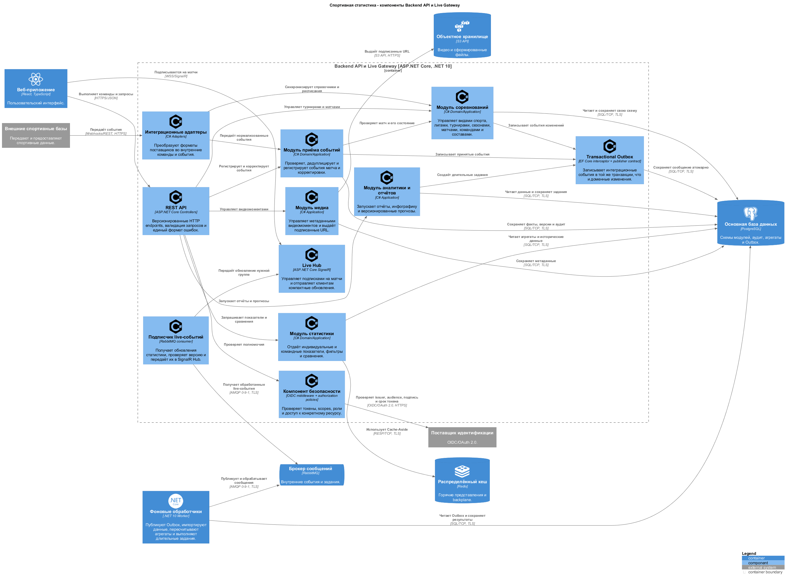

# C4 Level 3 — компоненты Backend API и Live Gateway

[Исходный код PlantUML](Компоненты.puml)

## Назначение

Диаграмма раскрывает внутреннее устройство главного серверного контейнера. Компоненты соответствуют предметным модулям модульного монолита и интеграционным механизмам из ADR.

## Основные компоненты

| Компонент | Ответственность |
|---|---|
| REST API | Версионированные endpoints, проверка входного формата и единые ошибки |
| Компонент безопасности | Проверка токенов, ролей, scopes и принадлежности ресурса |
| Модуль соревнований | Виды спорта, лиги, сезоны, турниры, матчи, команды и составы |
| Модуль приёма событий | Валидация, дедупликация, регистрация событий и корректировок |
| Модуль статистики | Показатели, фильтрация, сравнения и чтение агрегатов |
| Модуль аналитики и отчётов | Отчёты, инфографика и версионированные прогнозы |
| Модуль медиа | Метаданные видеомоментов и подписанные ссылки |
| Интеграционные адаптеры | Преобразование форматов поставщиков во внутреннюю модель |
| Transactional Outbox | Атомарная запись события вместе с изменением данных |
| Подписчик live-событий | Получение обработанных событий из RabbitMQ |
| Live Hub | Управление группами матчей и отправка обновлений клиентам |

## Правила зависимостей

1. Внешние поставщики не передают свои модели напрямую в доменное ядро — их преобразуют интеграционные адаптеры.
2. Каждый предметный модуль работает только со своей схемой PostgreSQL.
3. Межмодульное распространение изменений выполняется через явные контракты и события.
4. Outbox записывается в одной транзакции с доменным изменением.
5. Redis не используется для хранения единственной копии данных.
6. Live Hub передаёт уведомление, но восстановление состояния выполняется из подтверждённого снимка.

