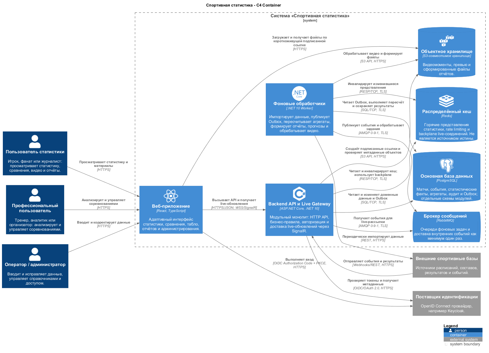

# C4 Level 2 — контейнеры системы

[Исходный код PlantUML](Контейнеры.puml)

## Назначение

Диаграмма показывает исполняемые приложения и хранилища системы. Контейнер в C4 — это не обязательно Docker-контейнер, а самостоятельно запускаемое приложение или хранилище данных.

## Контейнеры

| Контейнер | Технология | Ответственность |
|---|---|---|
| Веб-приложение | React, TypeScript | Пользовательский интерфейс и получение live-обновлений |
| Backend API и Live Gateway | ASP.NET Core, .NET 10 | HTTP API, бизнес-правила, авторизация и SignalR |
| Фоновые обработчики | .NET 10 Worker | Импорт, Outbox, пересчёт, отчёты, прогнозы и обработка видео |
| Основная база | PostgreSQL | Источник истины, аудит, агрегаты и Outbox |
| Распределённый кеш | Redis | Cache-Aside, rate limiting и SignalR backplane |
| Брокер сообщений | RabbitMQ | Очереди заданий и внутренние события |
| Объектное хранилище | S3-совместимое | Видео, превью и сформированные файлы |

## Протоколы взаимодействия

| Взаимодействие | Протокол |
|---|---|
| Браузер ↔ Backend API | HTTPS/JSON |
| Браузер ↔ Live Gateway | WSS/SignalR |
| Браузер ↔ поставщик идентификации | OIDC Authorization Code + PKCE |
| Сервер ↔ PostgreSQL | SQL/TCP с TLS |
| Сервер ↔ Redis | RESP/TCP с TLS |
| Сервер ↔ RabbitMQ | AMQP 0-9-1 с TLS |
| Сервер или браузер ↔ объектное хранилище | S3 API/HTTPS или подписанный HTTPS URL |
| Интеграция ↔ спортивная база | REST/Webhooks поверх HTTPS |

## Важные ограничения

- PostgreSQL — источник истины; потеря кеша не должна приводить к потере данных.
- RabbitMQ обеспечивает доставку как минимум один раз, поэтому обработчики должны быть идемпотентными.
- Клиент после переподключения SignalR запрашивает актуальный снимок и не полагается только на уведомления.
- Видеобайты не хранятся в PostgreSQL.
- Сбой прогнозирования, отчётов или видео не должен останавливать приём событий и онлайн-табло.

