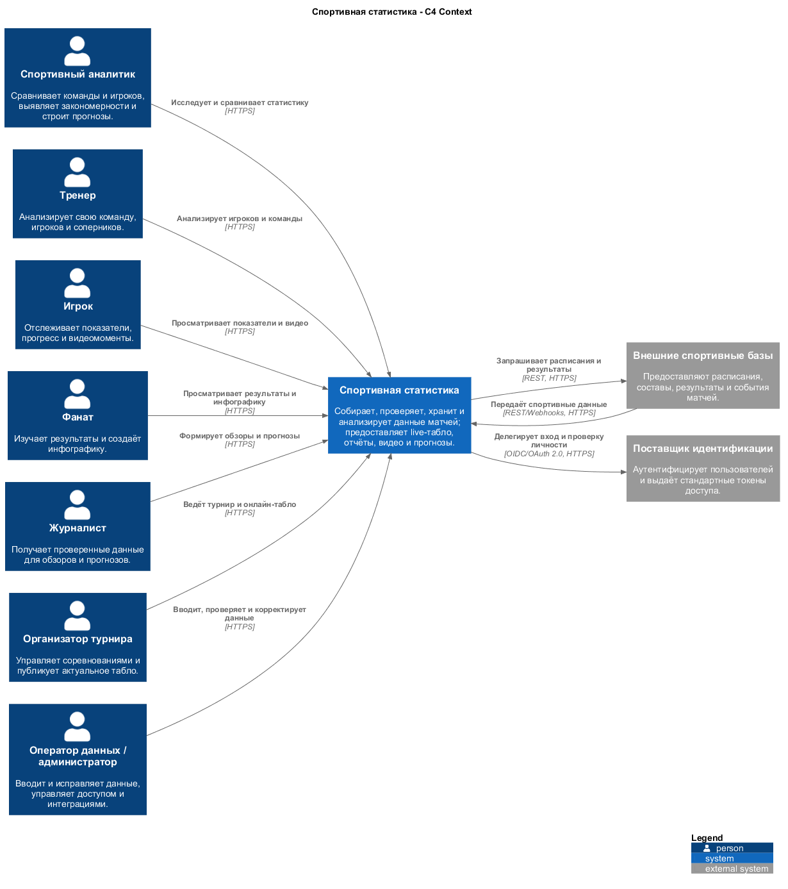

# C4 Level 1 — контекст системы

[Исходный код PlantUML](Контекст.puml)

## Назначение

Диаграмма показывает границы системы «Спортивная статистика», всех пользователей из технического задания и две категории внешних систем: поставщиков спортивных данных и поставщика идентификации.

## Участники

- спортивный аналитик;
- тренер;
- игрок;
- фанат;
- журналист;
- организатор турнира;
- оператор данных и администратор.

Оператор и администратор добавлены как технически необходимые роли для ввода, корректировки и защиты данных.

## Внешние взаимодействия

| Внешняя сторона | Направление | Содержание | Протокол |
|---|---|---|---|
| Пользователи | Пользователь → система | Работа с данными через веб-интерфейс | HTTPS |
| Спортивные базы | Двустороннее | События, результаты, расписания и составы | REST/Webhooks поверх HTTPS |
| Поставщик идентификации | Система → поставщик | Вход и проверка личности | OpenID Connect/OAuth 2.0 поверх HTTPS |

